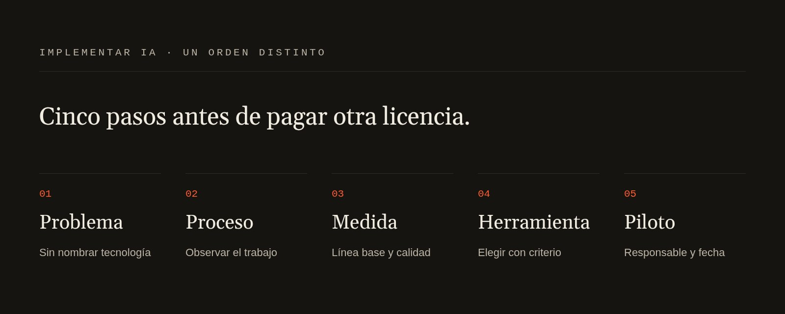

La conversación suele empezar igual. «Ya compramos licencias de ChatGPT para todo el equipo» o «Activamos Copilot hace tres meses». Y luego, casi en voz baja: «Pero no vemos que haya cambiado mucho».

El problema no es la herramienta. ChatGPT, Copilot y Gemini son capaces. El problema está en el orden: **cuando quieres implementar IA en tu empresa y empiezas por la herramienta, pones la respuesta antes que la pregunta.**

Es el error más caro porque no se nota de inmediato. Las licencias se pagan cada mes, el equipo las prueba con entusiasmo y, semanas después, el uso se reduce a redactar correos y resumir documentos. Nadie puede decir qué mejoró en el negocio.

En esta nota explico por qué ocurre, cómo reconocerlo y qué hacer en su lugar. No es hype. Son resultados, y los resultados empiezan antes de elegir la plataforma.

## Por qué las licencias de IA no se traducen en resultados

Comprar una herramienta da sensación de avance. Hay una factura, un anuncio interno y una capacitación. Es una decisión visible y fácil de tomar.

Cambiar la forma en que se hace el trabajo cuesta más. Exige elegir un proceso, entender sus excepciones, decidir quién revisa y medir antes y después. Por eso muchas empresas se quedan en la primera parte.

Los datos internacionales muestran esa brecha. En la encuesta [The state of AI in 2026 de McKinsey](https://www.mckinsey.com/capabilities/quantumblack/our-insights/the-state-of-ai), el 80 % de los encuestados dice que la IA mejoró su productividad individual. Sin embargo, solo el 37 % atribuye a la IA algún efecto en el EBIT, es decir, en el resultado operativo de su organización. Esa proporción prácticamente no cambió frente al año anterior.

Dicho de otra forma: las personas ganan tiempo, pero la empresa no siempre lo convierte en resultados. Ese tiempo se diluye cuando nadie decidió para qué usarlo.

### La herramienta acelera; el proceso decide

Una licencia mejora tareas sueltas. Alguien escribe más rápido una propuesta o resume una reunión en minutos. Eso tiene valor, pero rara vez mueve por sí solo los números del negocio.

El cambio aparece cuando rediseñas el flujo completo: quién recibe la solicitud, qué prepara la IA, quién valida y qué pasa con las excepciones. En la misma encuesta, casi tres cuartas partes de las organizaciones con mejor desempeño en IA dicen haber rediseñado a fondo sus flujos de trabajo. En el resto, lo hace apenas una cuarta parte.

### El 70 % del reto no es tecnológico

Boston Consulting Group llegó a una conclusión parecida en 2024, con su estudio [Where's the Value in AI?](https://www.bcg.com/press/24october2024-ai-adoption-in-2024-74-of-companies-struggle-to-achieve-and-scale-value), basado en una encuesta a 1.000 ejecutivos de 59 países. Alrededor del 70 % de los problemas al implementar IA proviene de las personas y los procesos, el 20 % de la tecnología y solo el 10 % de los algoritmos. Aun así, la parte técnica suele consumir una porción desproporcionada del tiempo y los recursos.

En ese estudio, el 74 % de las empresas todavía no mostraba valor tangible de la IA. Las líderes, en cambio, perseguían en promedio cerca de la mitad de las oportunidades que las demás. Elegían menos y las llevaban más lejos.

## Señales de que empezaste por la herramienta

¿Cómo saber si tu empresa cayó en este error? Estas señales aparecen con frecuencia:

- Puedes decir qué herramienta compraste, pero no qué problema resuelve.
- El indicador de éxito es cuántas personas la usan, no qué mejoró.
- Cada área la utiliza a su manera y nadie comparte lo que funciona.
- La capacitación explicó los menús de la plataforma, no casos del trabajo real.
- Nadie tiene la responsabilidad de que la inversión produzca algo.
- Cuando preguntas por el retorno, la respuesta es «ahorramos tiempo», sin saber cuánto ni en qué se usó.

Reconocer dos o tres no significa que la compra haya sido un error. Significa que falta la parte que convierte una herramienta en resultados.

### Un caso típico

Imagina una distribuidora con 40 personas entre ventas y atención al cliente. La gerencia compra licencias de un asistente de IA para todos y organiza una capacitación de dos horas. El primer mes, el uso es alto. Al tercero, la mitad del equipo dejó de abrirlo, y quienes siguen lo usan sobre todo para redactar correos.

Mientras tanto, el problema que más le cuesta a esa empresa sigue intacto. Las cotizaciones tardan dos días porque los precios y las existencias están repartidos en tres archivos distintos. Ninguna licencia resolvió eso, porque nadie lo planteó como objetivo.

## Cómo implementar IA en tu empresa empezando por el problema

El orden útil es el inverso. Primero el problema, después el proceso, luego la medida y, al final, la herramienta. Estos cinco pasos te sirven tanto si estás por comprar como si ya pagaste las licencias y quieres rescatar la inversión.

### 1. Escribe el problema sin nombrar ninguna tecnología

Antes de hablar de ChatGPT, Copilot o Gemini, describe en una frase lo que hoy le cuesta a tu negocio. Si puedes, incluye un dato:

> Hoy tardamos dos días en enviar una cotización y perdemos clientes que le compran a quien responde primero.

Si la frase menciona una herramienta, todavía no describe un problema. Describe una solución que busca dónde aplicarse. Y si no logras escribirla, el proyecto aún no está listo.

### 2. Elige un proceso concreto y obsérvalo

Pasa del problema al trabajo cotidiano. ¿Qué pasos sigue hoy una cotización? ¿Quién la prepara, de dónde saca la información y dónde se atasca?

Habla con quien hace la tarea. Esa persona conoce las excepciones, los atajos y los datos que siempre faltan. Muchas veces descubrirás que una parte del problema se resuelve ordenando información, incluso antes de usar IA.

En [tres decisiones antes de empezar un proyecto de IA](/blog/tres-decisiones-proyecto-ia/) explico con más detalle cómo escoger ese primer proceso y quién debe responder por él.

### 3. Define cómo vas a medir el resultado

Mide cómo funciona el proceso hoy, aunque sea con una muestra de casos. Elige un indicador principal ligado al negocio, como el tiempo de respuesta, los errores, las ventas cerradas o el costo por caso. Añade una condición de calidad que deba mantenerse.

Sin una línea base, cualquier mejora es una opinión. Con ella, podrás decidir con datos si continuar, ajustar o detener.

### 4. Ahora sí, elige la herramienta

Con el problema, el proceso y la medida claros, la elección se simplifica. Ya no preguntas cuál es la mejor IA del mercado. Preguntas cuál resuelve este trabajo con tus sistemas, tus datos y tu presupuesto.

A veces la respuesta es la licencia que ya tienes, bien configurada. A veces es una automatización sencilla. Otras veces el proceso necesita un sistema con más autonomía; en [agentes de IA para negocios](/blog/agentes-ia-negocios/) explico cuándo vale la pena dar ese paso. Y también puede pasar que la solución no requiera IA.

Para comparar opciones, usa preguntas prácticas:

- ¿Se integra con lo que ya usamos, como el correo, el CRM o el ERP?
- ¿Dónde se guardan nuestros datos y quién puede verlos?
- ¿Cuánto cuesta por caso resuelto, y no solo por usuario al mes?
- ¿Quién la mantendrá cuando termine la implementación?

### 5. Prueba en pequeño, con un responsable y una fecha de decisión

Lanza un piloto con pocas personas, un solo proceso y un período definido. Asigna un responsable del negocio, no solo de tecnología, con autoridad para ajustar o detener la prueba.

Fija desde el inicio cuándo revisarás los resultados y qué tendría que pasar para ampliar. En 2024, Gartner anticipó que [al menos el 30 % de los proyectos de IA generativa se abandonaría después de la prueba de concepto](https://www.gartner.com/en/newsroom/press-releases/2024-07-29-gartner-predicts-30-percent-of-generative-ai-projects-will-be-abandoned-after-proof-of-concept-by-end-of-2025) antes de terminar 2025. Entre las causas mencionaba datos de mala calidad, costos crecientes y un valor de negocio poco claro.

Un piloto con medida y fecha de decisión no elimina ese riesgo, pero lo reduce: obliga a demostrar valor antes de crecer.

## Checklist antes de pagar otra licencia de IA

Lleva esta lista a tu próxima reunión de dirección:

| Pregunta | Si la respuesta es «no» |
| --- | --- |
| ¿Podemos describir el problema en una frase, sin nombrar tecnología? | Define el problema antes de comprar |
| ¿Sabemos qué proceso va a cambiar y cómo funciona hoy? | Obsérvalo con quien hace el trabajo |
| ¿Medimos hoy el resultado que queremos mejorar? | Mide una muestra de casos |
| ¿Hay un responsable del negocio, con nombre y tiempo? | Asígnalo antes de empezar |
| ¿Está claro qué hace la IA y qué revisa una persona? | Define revisiones y excepciones |
| ¿Acordamos cuándo y cómo decidiremos si seguir? | Ponle fecha y criterio al piloto |

Si respondes «sí» a las seis, elegir la herramienta será una decisión informada. Si no, cualquier herramienta será una apuesta.

## Si ya compraste las licencias, todavía estás a tiempo

No hace falta cancelar nada. Trata las licencias como un recurso disponible y aplica el método al revés: elige un problema que esa herramienta pueda atacar, define la medida y asigna un responsable.

Empieza con un equipo pequeño y un caso concreto. Documenta cómo se hace la tarea con IA: las instrucciones que funcionan, qué se revisa y qué no se delega. Cuando ese caso muestre resultados, compártelo con el resto de la empresa. Un caso con números convence más que diez capacitaciones genéricas.

Forma a las personas en su trabajo real, no en los menús de la plataforma. La adopción crece cuando cada persona ve qué tarea suya mejora y cuánto.

## Preguntas frecuentes sobre implementar IA en una empresa

### ¿Por qué mi empresa no ve resultados con ChatGPT o Copilot?

Casi siempre porque la herramienta llegó sin un problema de negocio definido ni una forma de medir. Las personas la usan para tareas sueltas, el tiempo ahorrado no se reasigna y nadie mide el efecto en el proceso. Elegir un caso, medirlo y asignarle un responsable suele cambiar la situación.

### ¿Por dónde empiezo a implementar IA si tengo una pyme?

Por un proceso que se repita y que hoy te cueste tiempo, errores o clientes, y del que tengas información disponible. Descríbelo en una frase, mide cómo funciona y prueba una solución pequeña antes de invertir más.

### ¿Cuánto tarda en verse el retorno de la IA?

Depende del proceso y del volumen de trabajo. Un piloto bien acotado debería mostrar señales dentro de su período de prueba, porque la métrica y la fecha de revisión se fijaron al inicio. Sin esas dos cosas, el retorno será difícil de ver en cualquier plazo.

### ¿Necesito un equipo técnico para empezar?

No para empezar. Las primeras decisiones son de negocio: qué problema, qué proceso, qué métrica y quién responde. El apoyo técnico se vuelve necesario cuando hay que integrar sistemas, conectar datos sensibles o escalar la solución.

## Primero la pregunta, después la plataforma

La IA puede cambiar la forma en que trabaja tu empresa, pero ese cambio no viene incluido en la licencia. Viene de decidir qué problema importa, rediseñar el trabajo alrededor de él y medir lo que pasa.

Cuando [acompaño a una empresa](https://santisteban.co) en este proceso, procuro que la primera conversación no sea «¿qué herramienta compramos?», sino «¿qué nos está costando más hoy?». Esa pregunta suele ordenar todo lo demás.

**¿Qué problema de tu negocio resolverías primero si la herramienta todavía no existiera?**

Esa respuesta es tu verdadero punto de partida.

*La distribuidora y el caso de las cotizaciones son ejemplos ilustrativos, no casos de clientes.*
